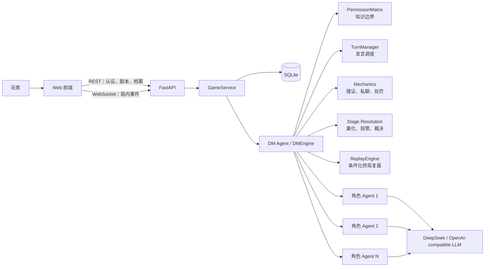

# 剧镜 · AI 悬疑推理 MVP

剧镜是一个以 AI 角色 Agent 驱动的悬疑推理 Web 项目。玩家登录后导入结构化案件、选择一个角色亲自扮演；DMEngine 掌握完整剧本和真相，为其余角色创建独立子 Agent，并以确定性规则控制阶段、知识分发、投票和终局。目前 DM 主持文案来自剧本预设，前端逐段展示，不是大模型实时生成的智能 DM。

当前版本优先把“悬疑推理 + 推理对抗”做成可完整体验的 Web MVP。Windows 启动器可以一键启动本地服务并打开页面；真正嵌入独立窗口的原生桌面壳将在 Web 主流程成熟后继续开发。

## 当前形态

- 前端：Vue 3 + Vue Router + Pinia；认证与 AppShell 已组件化，案件页面通过 legacy DOM 适配层渐进迁移。
- 后端：FastAPI 提供 REST API、WebSocket 和静态资源托管。
- AI：OpenAI-compatible 接口，已支持 DeepSeek；无密钥时可使用 Echo 模式开发测试。
- 数据：SQLite 本地保存用户、登录会话、案件、游戏进度和事件记录。
- Windows：可双击批处理启动，也可使用 PyInstaller 构建本地启动程序。
- MVP 范围：只开放悬疑推理题材和 deduction 推理对抗模式。

## 核心流程

```text
注册 / 登录
  → 上传 JSON 案件或载入内置案件
  → 后端校验剧本、模式和可扮演角色
  → 玩家选择 1 个角色
  → DM Agent 读取完整真相
  → 为其他 N - 1 个角色创建独立子 Agent
  → DM 全屏逐段展示预设故事背景、本幕背景和公开任务
  → 向玩家发放所选角色的私人剧本与个人任务
  → 开放本幕配置的公开询问 / 搜证 / 秘密询问
  → 玩家和角色 Agent 搜到线索后，可保密、如实分享或扭曲后分享
  → 角色 Agent 即使没有真人触发，也会按个人任务自主交流或搜证
  → 实时显示真人调查进度；倒计时归零，或全员结束投票严格过半
  → DM 主持收束本幕，按真实操作量化每个角色的阶段成果
  → 真人与角色 Agent 分别投票，DM 公布票型并执行下一幕处罚 / 任务
  → 按剧本配置重复“开场 / 私人剧本 / 调查 / 主持”
  → 最终幕强制完成最终指认，DM 必须发布对应结局
  → 指认正确则祝贺玩家并公开完整真相；错误则形成错误结局且不泄露真凶
  → 公开全部角色的线索本、推理结论和操作时间线
  → 事件与角色记录保存到当前用户
```

内置案件为《雾港档案·钟楼夜宴》：4 个可扮演角色、3 个角色 Agent、3 个调查阶段和 5 个分阶段搜证地点。
三个调查阶段分别配置可用操作、倒计时和结束条件，因此不同幕可以关闭私聊、改变搜证要求或采用不同的主持内容。

## 已实现能力

| 模块 | 当前能力 |
| --- | --- |
| 用户系统 | 注册、登录、退出、PBKDF2-SHA256 密码哈希、随机会话令牌；数据库令牌摘要不能用于登录 |
| 用户隔离 | 每个用户只能读取自己的案件和事件记录 |
| 剧本导入 | 上传 UTF-8 JSON、嵌套结构与基本可运行校验、角色预览；内置案件只传白名单 ID，全文留在后端 |
| DM 编排 | 读取完整剧本、四阶段状态机、预设主持文案逐段展示、情报投递、审计记录和终局复盘 |
| 角色 Agent | 按剧本动态创建，持有独立任务、阶段知识、私聊记忆、私有线索和全体公开角色表，并可自主交流或搜证 |
| 身份识别 | 所有 Agent 在处理发言、私聊和行动前，先按 `role_id` 确认行动者角色、公开身份与操控者类型 |
| 知识边界 | 读取、注入与恢复共用阶段 / 所有者校验；公开 DM 公告进入实际模型输入；已知边界有负向回归，不等于证明模型绝不泄密 |
| 公开询问 | 玩家发言后由回合管理器选择有限数量的角色回应 |
| 搜证 | 每个角色按剧本配置和当前阶段独立获得行动次数；线索归获得者私有 |
| 线索披露 | 玩家和 Agent 均可继续保密、如实公开、扭曲后公开，或在已建立的私聊中定向分享 |
| 秘密询问 | 角色可自主接受或拒绝；私聊上下文不进入公开历史 |
| Agent 自主行动 | 调查期按任务主动公聊、私聊或搜证，并自主决定是否以及如何披露所得线索 |
| 阶段推进 | DM 开场、私人发本、限时调查、全员结束投票、DM 收束按剧本循环；Agent 不会替真人触发提前收束 |
| 结束投票 | 真人点击后自动投同意票，其余角色 Agent 独立表态；同意票严格超过总角色数一半才结束 |
| 阶段量化 | 每幕按真实搜证、发言、回应和线索披露事件为所有角色结算增量与累计成果 |
| 集体决策 | 严格解析每个角色的选票，失败不代投且整轮可重试；提前公布固定平票规则，执行下一幕限制或任务 |
| 任务判定 | 正式行动次数与线索披露可规则判定；个人叙事目标单列为需人工评审，不把贡献分当任务成功 |
| 最终裁决 | 最终幕必须完成指认；DM 对照隐藏真相发布正确或错误结局，只有正确时公开完整真相 |
| 线索记录本 | 自动记录案件背景、DM 信息、角色剧本、任务、搜证与直接交流；玩家手记按真实幕次/环节保存修订，旧未知幕次明确标记 |
| 上下文与记忆 | 按角色/接收者/幕数过滤结构化事实、证词与推断；词法取回旧档案，固定 system 与动态 user 数据分层，总预算及省略来源可审计 |
| 调用观测 | 独立记录模型准备、完成、失败和取消尝试，不随游戏回滚抹掉；版本、耗时、usage 与提交状态可复盘，缺失数据不补造 |
| 终局角色审计 | 案件结束后按角色对照搜证原文、对外说法、披露方式、推理记录和全部操作，局中禁止访问 |
| 案件档案 | SQLite 事务保存事件、快照与命令幂等结果，失败恢复内存；跨服务重启继续、分页续传、查看与两步确认删除 |
| 模型接入 | Echo 与 OpenAI-compatible 两种 Provider，支持超时和可读错误 |
| UI/UX | DM 全屏主持、私人剧本、悬疑工作台、半透明 Liquid Glass、角色身份头像，以及公聊声纹、私聊双人链路、搜证扫描三套动态状态 |

## Agent 架构



DMEngine 是唯一持有完整 `truth` 的编排者。角色子 Agent 不共享完整剧本，只接收自己的身份、目标、已解锁知识和授权对话。读取、实际 Prompt 和快照恢复均校验边界；这属于应用层隔离，不是独立安全沙箱，也不保证自然语言模型不会猜测或编造。

DM 负责控制自主行动频率、轮换行动角色和校验知识边界；具体交流对象、公开或私下频道、是否搜证以及线索披露策略由本轮角色 Agent 根据个人任务自主决定。System Prompt 只保留固定玩法与身份识别/信任协议；公开角色表、个人目标和授权记忆以 `ROLE_MEMORY_DATA` 动态 user 数据输入。收到结构化 `OBSERVED_EVENT` 后先确认行动者身份，再结合关系、任务与知识边界作出反应。

案件内档案保存不等于每轮全量输入。`AgentInstance.prepare()` 按权限检查并取回相关旧记录，保留当前必要信息，最终消息检查预算；必要任务过大时明确失败，不静默截掉事实。证词和自我推断保持未核实；取回使用词法匹配，不是向量语义检索，也不是跨案件长期学习。

真实搜证内容只写入获得者的私有线索账本和 DM 审计。其他角色在局中只会收到持有人实际发布的“对外说法”，不会知道它是原文还是扭曲版本。Agent 间私聊在游戏过程中只写入双方私密记忆和受控审计，真人只能看到发生了私下交流，不会看到内容。案件结束后，终局角色审计才开放原始线索、披露说法、推理结论、公开/私下交流和操作时间线，用于评估子 Agent 是否保持角色一致性和有效调查能力。

## 目录结构

```text
RolePlayingGame/
├── frontend/
│   ├── index.html                  # 登录、建案、档案和局内工作台
│   ├── styles.css                 # 悬疑视觉与 Liquid Glass 交互
│   ├── app.js                     # Vite 生成的生产兼容入口
│   ├── package.json               # 前端构建、类型检查和测试命令
│   ├── vite.config.ts             # 开发代理与生产 IIFE 构建
│   ├── src/
│   │   ├── App.vue                # Vue 壳层与 Teleport 挂载
│   │   ├── components/            # 认证页与应用侧栏组件
│   │   ├── stores/                # auth/ui Pinia stores
│   │   ├── legacy-app.js          # 现有页面渲染与交互，待逐页组件化
│   │   ├── api-client.ts          # REST v1、CSRF 与统一错误
│   │   ├── router.ts              # Vue Router 资源路由与安全返回路径
│   │   ├── state.ts               # 集中状态初始模型
│   │   └── ws-protocol.ts         # WS 命令、校验、去重与续传归约
│   └── assets/                    # 本地视觉资源
├── backend/
│   ├── app/
│   │   ├── main.py                # FastAPI 入口和接口
│   │   ├── game_service.py        # 游戏创建、会话恢复和持久化协调
│   │   ├── dm/                    # DM 编排、权限、回合、校验和复盘
│   │   ├── agent/                 # 角色 Agent 与 AgentPool
│   │   ├── mechanics/             # 搜证、秘密询问
│   │   ├── skill/                 # narrative、deduction、faction
│   │   ├── llm/                   # Echo 与 OpenAI-compatible 客户端
│   │   └── storage.py             # SQLite 数据访问
│   ├── config/
│   │   ├── .env                   # 本机配置，不进入版本控制
│   │   └── .env.example           # 配置模板
│   ├── resources/scripts/         # 内置案件与回归测试剧本
│   ├── data/                      # 源码运行时数据库
│   ├── tests/                     # 单元与集成测试
│   └── requirements.txt
├── desktop/
│   ├── launch_desktop.py          # 源码模式的一键启动入口
│   ├── desktop_launcher.py        # PyInstaller 打包入口
│   └── build_windows_exe.ps1      # PyInstaller 构建脚本
├── docs/                          # 需求、架构、设计与实现复盘
├── 启动桌面版.bat
└── README.md
```

FastAPI 继续同源托管 `frontend/index.html`、`styles.css` 和构建后的 `app.js`。日常前端开发可使用 Vite 开发服务器；Vite 将 `/api` 与 `/ws` 代理到本机 8000 端口，生产和桌面版本不引入跨域依赖。

## 快速启动

运行环境建议使用 Python 3.10 或更高版本、Node.js 22 或更高版本。

### 1. 安装依赖

```powershell
python -m pip install -r backend\requirements.txt
Set-Location frontend
npm.cmd ci
npm.cmd run build
Set-Location ..
```

### 2. 配置模型

后端启动时自动读取 [backend/config/.env](backend/config/.env)，系统环境变量优先于文件配置。若本机还没有该文件，可从模板创建：

```powershell
Copy-Item backend\config\.env.example backend\config\.env
```

使用 DeepSeek 等 OpenAI-compatible 服务时填写：

```dotenv
LLM_PROVIDER=openai_compatible
LLM_MODEL=你的模型ID
LLM_BASE_URL=https://api.deepseek.com
LLM_TIMEOUT_SECONDS=120
LLM_API_KEY=你的API_KEY
```

上下文保护默认配置如下，可在同一个 `.env` 中调整；输入、输出和安全余量之和不得超过配置窗口：

```dotenv
# 应用预算，不是宣称当前模型只有这个窗口
LLM_CONTEXT_WINDOW=32768
LLM_INPUT_TOKEN_LIMIT=23000
LLM_MAX_OUTPUT_TOKENS=8192
LLM_TOKEN_SAFETY_MARGIN=1024
# 留空不覆盖服务商默认行为；不是所有兼容服务都支持该参数
LLM_REASONING_EFFORT=
```

输入使用 UTF-8 字节保守估算，不是服务商精确 tokenizer；实际 usage 单独保存。输出截断明确失败，不执行为完整行动。默认思考模式在上述额度下的整局行为仍需新局验证。

只调试业务流程、不调用付费模型时可使用：

```dotenv
LLM_PROVIDER=echo
```

认证默认使用 HttpOnly Session Cookie。公网生产环境必须配置：

```dotenv
APP_ENV=production
COOKIE_SECURE=true
```

生产环境必须通过 HTTPS 访问；浏览器写操作同时校验 CSRF token。开发环境使用同源 HTTP Cookie，方便在 `127.0.0.1` 调试。

不要把真实 API Key 写入前端、`.env.example` 或提交记录。`.gitignore` 已忽略所有 `.env` 文件。

调查阶段的角色自主行动会自动产生模型请求。可通过剧本中的 `autonomy.initial_delay_seconds`、`interval_seconds` 和 `max_turns` 控制调用节奏与单幕上限。

### 3. 启动服务

```powershell
python -m uvicorn main:app --app-dir backend\app --host 127.0.0.1 --port 8000
```

打开 [http://127.0.0.1:8000/](http://127.0.0.1:8000/)。健康检查地址为 [http://127.0.0.1:8000/health](http://127.0.0.1:8000/health)。

需要前端热更新时，保持后端 8000 端口运行，并在另一个终端执行：

```powershell
Set-Location frontend
npm.cmd run dev
```

然后打开 Vite 输出的本地地址。生产入口仍以 FastAPI 的 8000 端口为准。

## Windows 点开即用

双击 `启动桌面版.bat` 会启动本地 FastAPI 服务并打开系统默认浏览器。命令窗口需要保持开启，关闭窗口会停止本地服务。

构建 PyInstaller 版本前先安装 PyInstaller，并确保 Node.js/npm 可用。构建脚本会先执行 `npm ci` 和前端生产构建，再调用 PyInstaller，避免打包过期资源：

```powershell
python -m pip install pyinstaller
powershell -ExecutionPolicy Bypass -File desktop\build_windows_exe.ps1
```

构建产物：

```text
dist\AIMurderMysteryDesktop\AIMurderMysteryDesktop.exe
```

源码运行时数据库位于 `backend/data/app.db`；打包运行时数据库位于：

```text
%LOCALAPPDATA%\AIMurderMystery\app.db
```

## 剧本格式

上传文件必须是 UTF-8 JSON。最小结构包括：

```text
script_meta.script_id
script_meta.title
script_meta.total_stages
script_meta.supported_skills
story_background
roles[]
roles[].role_id
roles[].role_name
roles[].human_playable
roles[].public_identity
roles[].stage_knowledge
truth
```

可选的 `mechanics_enabled` 和 `mechanics_config` 用于启用搜证、私聊次数和角色登场阶段等规则。`stage_flow.stage_N` 用于声明每一幕的公开背景、公开任务、个人任务、调查规则、DM 收束词和阶段结算。最终幕必须配置 `final_decision`，`truth.culprit_role_id` 保存只供 DM 判定的真实凶手。玩家选择一个 `human_playable` 角色后，其余角色各创建一个子 Agent。

```text
stage_flow.stage_N.title
stage_flow.stage_N.public_briefing
stage_flow.stage_N.public_tasks[]
stage_flow.stage_N.personal_tasks.{role_id}
stage_flow.stage_N.investigation.duration_seconds
stage_flow.stage_N.investigation.enabled_actions[]
stage_flow.stage_N.investigation.end_conditions
stage_flow.stage_N.investigation.end_conditions.actor_scope
stage_flow.stage_N.investigation.end_conditions.auto_end
stage_flow.stage_N.investigation.autonomy.enabled
stage_flow.stage_N.investigation.autonomy.initial_delay_seconds
stage_flow.stage_N.investigation.autonomy.interval_seconds
stage_flow.stage_N.investigation.autonomy.max_turns
stage_flow.stage_N.investigation.autonomy.allow_private
stage_flow.stage_N.resolution.title
stage_flow.stage_N.resolution.metric.{key,label,unit,initial}
stage_flow.stage_N.resolution.scoring_rules[]
stage_flow.stage_N.resolution.vote
stage_flow.stage_N.resolution.vote.eligible_role_ids[]
stage_flow.stage_N.resolution.vote.penalty
stage_flow.stage_N.resolution.final_decision
stage_flow.stage_N.dm_hosting
truth.culprit_role_id
```

`scoring_rules[].event_types` 把真实局内事件映射为分值，`points_per_event` 和 `max_points` 控制单项计分。普通幕可使用 `vote.penalty` 配置目标幕、搜证行动点削减和额外任务；最终幕使用 `final_decision` 配置候选角色与正确 / 错误结局文案。角色 Agent 只获得候选人、公开经历和自己的私有目标，不会收到 `truth.culprit_role_id`。

`end_conditions.actor_scope` 默认为 `human`，表示建议进度只统计真人操作；设为 `all` 才统计所有角色。`auto_end` 只能为 `false`，导入拒绝 `true`。操作次数达成仅提示建议目标；调查只能在倒计时归零，或真人发起的全员结束投票严格过半时结束。超时后的新行动及迟到的模型回复不作为有效行动执行。

个人任务文本不自动等于可判定目标。`stage_flow.stage_N.personal_task_checks.{role_id}[]` 与 `stage_flow.stage_N.resolution.vote.penalty.completion_checks[]` 可声明行动次数或正式线索披露规则，细节见内置案件与整改记录。未声明规则的叙事目标标为“需人工评审”；`new_public` 根据正式披露记录判定，不解析聊天中的同义转述。正确 / 错误结局模板及其他角色任务详情不在局中下发给玩家。

完整示例见 [backend/resources/scripts/fog_harbor_clocktower.json](backend/resources/scripts/fog_harbor_clocktower.json)。

## 接口概览

| 接口 | 用途 |
| --- | --- |
| `GET /health` | 服务健康检查 |
| `POST /api/v1/auth/register` | 注册并创建 HttpOnly Cookie 会话 |
| `POST /api/v1/auth/login` | 登录并创建 HttpOnly Cookie 会话 |
| `POST /api/v1/auth/logout` | 撤销当前会话并清除 Cookie |
| `GET /api/v1/me` | 获取当前用户和 CSRF token |
| `POST /api/v1/scripts/inspect` | 校验并预览上传剧本 |
| `GET /api/v1/scripts/example` | 获取内置案件安全预览，不含全文与真相 |
| `POST /api/v1/games` | 创建游戏并启动 DM |
| `GET /api/v1/games` | 查询当前用户案件 |
| `GET /api/v1/games/{game_id}` | 查询案件及领域事件 |
| `GET /api/v1/games/{game_id}/events` | 按 `after_event_id` 增量查询实时事件 |
| `DELETE /api/v1/games/{game_id}` | 删除当前用户案件及其关联记录 |
| `GET /api/v1/games/{game_id}/notebook` | 获取玩家自动归档、私有搜证线索与推理手记 |
| `PUT /api/v1/games/{game_id}/notebook/manual` | 保存玩家推理手记 |
| `GET /api/v1/games/{game_id}/role-records` | 结局后查看全部角色记录 |
| `POST /api/v1/games/{game_id}/ws-ticket` | 获取 30 秒一次性 WebSocket 票据 |
| `WS /ws/v1/games/{game_id}?ticket=...&after_event_id=...` | 建立版本化实时连接并按游标续传 |

`/api/v1` 错误统一返回 `code`、`message`、`request_id`、`details`；响应头同时携带
`X-Request-ID`。WebSocket v1 使用严格命令/事件信封，每个客户端命令携带
`request_id`，每个持久化服务端事件携带单调递增的 `event_id`。

## 运行测试

```powershell
python -m backend.tests.run_isolated
Set-Location frontend
npm.cmd run typecheck
npm.cmd test
npm.cmd run build
Set-Location ..
node --check frontend\app.js
```

2026-10-05 核心整改阶段的历史结果（记忆后续整改见下方）：

- 127 项 Python 单元 / 集成测试、20 项前端测试通过；类型检查、生产构建、JS 语法及 Python 编译检查通过。
- 新增负向测试覆盖未来 / 他人 / DM 信息、旧秘密模板、过期行动、失败投票、无效结局、保存故障、摘要凭据与非法剧本。
- 真实 WebSocket 测试确认 1000 条积压分 5 页续传，随后实时事件不跳号；保存故障后同 ID 不重复执行，新 ID 才重新尝试。
- Echo 浏览器完成三幕，验证严格过半结束票、处罚、正式线索披露、量化子目标、最终指认及全部角色记录。错误指认分支由后端回归覆盖。
- 实测 1280×720、1024×768、390×844、320×568 调查布局；窄屏输入可达、页面无横向溢出，桌面侧栏收起 / 恢复正常。
- 原 8000 地址日常升级测试发现旧 JS 缓存问题，已增加构建内容哈希和缓存再验证，复测内置案件加载成功。
- 长推理期间发送不推进游标的心跳，增量重连后重新同步当前阶段；待确认命令仅在当前幕次 / 环节内用原 ID 重试，主动退出或页面刷新不自动重放。

专项过程、故障复现和截图见 [整改执行与逐项验收记录](docs/engineering/17-整改执行与逐项验收记录.md)。以上自动化和 Echo 结果不是 DeepSeek 质量、单局成本或生产负载结论；真实模型日常验收另行记录。

同日使用现有 DeepSeek 配置在新 QA 案件完成三幕：最终顾临川 3 票、沈知微 1 票，明确结局与四角色记录可打开，保留 48 条已完成调用输入。运行中有修复介入和自然断线，不是首次无干预通过；详见 [日常真实验收](docs/engineering/18-日常场景真实模型验收.md)。

同日文档 20 的历史记忆整改结果：157 项后端、21 项前端测试通过；类型检查、构建、语法和编译通过，15 项记忆诊断通过。30 个合成输入检查与万条私人档案预算/取回检查通过，不代表真实语义召回率。当时授权的 6 次短 DeepSeek 请求严格 5 PASS、1 FAIL（答案字段格式，未核实标签正确），实际 usage 4421 tokens，无重试、无追加调用、未改生产配置。原地址旧案件复盘桌面/移动走查通过，完整证据和限制见 [记忆整改与验收](docs/engineering/20-上下文与记忆整改及完整验收.md)；当时没有运行整改后的付费完整新局。

后续用户将验收上限提高至 100 次：本批实际 72 次（71 完成、1 取消），加上述 6 次共 78 次。生产默认参数原案三幕完整完成，未热修运行中的规则，最终 3:1 指认；额外错判、自然超时、重启恢复、真实断线取消及幂等检查完成。12 项短记忆检查严格 10 PASS / 2 FAIL，失败均为答案字段扩写，未核实标签正确，原始 FAIL 保留。终局 QA 桌面/移动记录走查通过。

真实测试又发现总请求超时缺失、保密搜证错误要求接收者，已先复现再修复；最终 169 项后端、21 项前端回归通过，完整 Echo 20 PASS / 1 NOT_RUN。最后两个补丁之后没有再跑付费完整原案，不能据此宣称所有真实行为通过。真实局没有成功的 AI 搜证；案件事实编造、串行指认约 191 秒、错判后全角色审计暴露凶手仍待处理。详见 [百次额度验收与客观评估](docs/engineering/21-百次额度真实模型完整验收与客观评估.md)，不标 M2–M5 完成。

## 视觉与交互

界面采用冷黑案发现场、旧纸文字、黄铜线索色、暗红行动色和雾绿在线状态。玻璃材质主要用于导航、工具栏、输入区和临时状态；证词、情报和角色记录使用更厚的阅读材质，避免背景穿透影响长文本。

按钮、角色选项和上传区域使用不对称曲率。点击时会从真实指针位置产生短暂的冷白、雾绿与暗红扩散，并完成压缩、偏斜和恢复。系统开启“减少动态效果”时，动画会自动降级。

角色头像使用统一的身份色和末字印记，不依赖固定剧本图片，因此上传自定义角色后仍能稳定生成。角色公开发言时头像产生声纹脉冲，搜证时出现纵向扫描，私聊期间双方头像在询问记录顶部持续显示并以同频呼吸提示保密链路；历史消息只播放短动画，不会永久闪烁。

左下账户头像使用独立的在线状态动效：登录后持续显示低强度五段频谱和在线信标；进入剧本演绎后，头像内部切换为雾绿、冷蓝、黄铜和暗红组成的动态思考波形。动效只表达状态，不自动播放声音；系统开启“减少动态效果”时同样会停止持续动画。

DM 开场、私人剧本和 DM 收束使用独立全屏场景，调查环节才显示操作工作台。DM 收束页会列出各角色贡献分、计分原因、候选人、票型和处罚；只显示当前玩家的私有任务结果，终局才开放全部角色记录。窗口宽度大于 1180px 时同时展示三栏；紧凑窗口使用等宽分段标签。正文 14px、角色说明和任务标签 12px、发言输入 16px。桌面可从账户区隐藏导航并从标题栏恢复，移动端保留顶部导航。

## MVP 边界

- 当前是单机本地账户，不是云端多用户服务。
- 一局游戏当前由 1 名真人玩家和 N - 1 个 AI 角色组成。
- 上传格式暂时只支持结构化 JSON，不解析 PDF、Word 或纯文本剧本。
- Windows 启动器当前打开系统浏览器，不是最终原生桌面窗口。
- 已完成操作保存版本化快照；服务端不会从快照恢复尚未提交的 LLM 执行。同一页面的待确认命令可在同幕同环节重连后按原 ID 重试，刷新或退出页面不保留该队列。
- 调查倒计时和 Agent 自主调度使用持久化绝对时间；系统时间被人为大幅修改时，剩余时间也会随之变化。
- 快照保存在本机 SQLite 中，当前属于本地应用级数据保护，不是加密的云端多租户存储。
- narrative、faction 等底层 Skill 仍保留，但没有在当前 MVP 前台开放。
- 个人叙事任务尚无自动语义裁判及完整人工评审工作台。
- 长推理仍会阻塞真人命令，分幕投票串行等待。失败/取消尝试独立审计与真人手记幕次/修订已补齐；硬崩溃或磁盘不可写时终态仍可能未知，留存/加密及账单对账尚未实现。
- Provider 总请求时限和保密搜证接收者校验已补回归；最终补丁后的完整付费原案仍未复验。角色可新增未设定的证据细节，不能以正确指认代替事实来源和扮演质量检查。
- 错判复盘正文不公开真相，但全角色记录及实际输入仍可揭示真凶；玩家复盘与开发者审计尚未分权，需明确终局秘密公开规则。
- 记忆取回当前为词法匹配，语义召回、模型引用核验、长局档案增长治理与多实例测试仍待完成。内置凶手初始目标已包含换药概况，药物与完整过程第二幕补发；起始知情粒度仍需按剧本设定明确。
- 游戏页与建案页仍以 legacy DOM 适配层实现；缺少仓库内完整浏览器 E2E / CI、多局真实模型评测、负载及全面无障碍验收。
- 已识别的构建工具依赖公告、备份恢复与公网费用滥用防护仍需单独处理，不能视为生产就绪。

## 项目文档

- [需求分析](docs/剧本杀-需求分析文档.md)
- [系统设计](docs/剧本杀-系统设计文档.md)
- [UI/UX 设计稿](docs/剧镜-UI-UX设计稿.md)
- [工程视角评估文档](docs/engineering/README.md)
- [全面检查与客观评估](docs/engineering/16-项目全面检查与客观评估.md)
- [整改执行与逐项验收记录](docs/engineering/17-整改执行与逐项验收记录.md)
- [日常场景真实模型验收](docs/engineering/18-日常场景真实模型验收.md)
- [上下文与记忆评估基线](docs/engineering/19-上下文与记忆系统评估验证.md)
- [上下文与记忆整改及完整验收](docs/engineering/20-上下文与记忆整改及完整验收.md)
- [百次额度真实模型完整验收与客观评估](docs/engineering/21-百次额度真实模型完整验收与客观评估.md)
- [实施方案](docs/剧本杀-实施方案.md)
- [全流程架构图](docs/剧本杀-全流程架构图.md)
- [知识边界隔离](docs/剧本杀-知识边界隔离.md)
- [实现过程记录](docs/实现过程记录.md)
- [悬疑推理 MVP 后续开发路线与跟进](docs/悬疑推理MVP-后续开发路线.md)

实现过程记录按模块持续整理了设计决策、实现步骤、实际问题、解决方式、测试结果和可复用开发经验。
