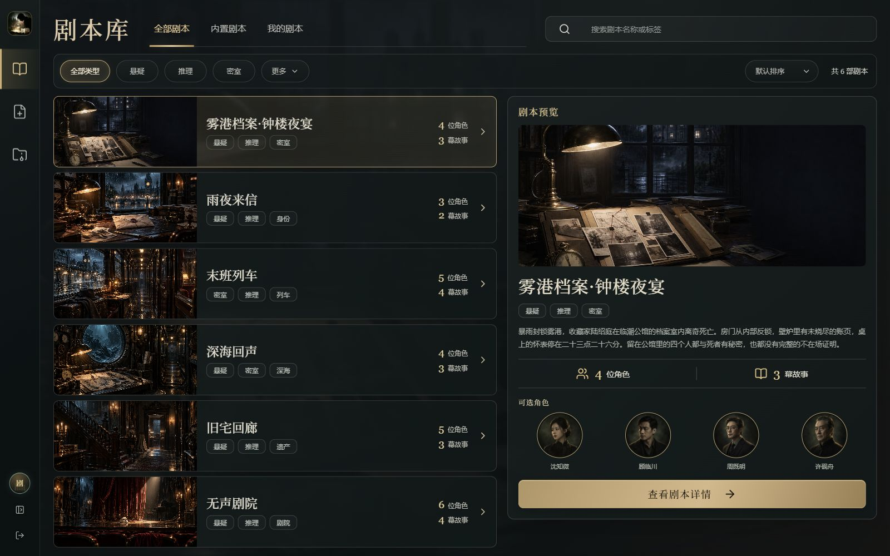
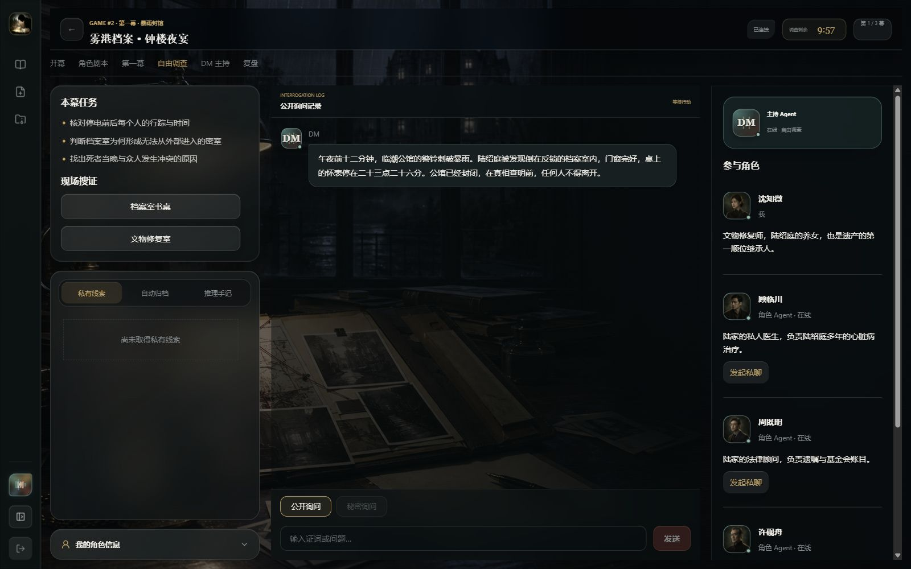
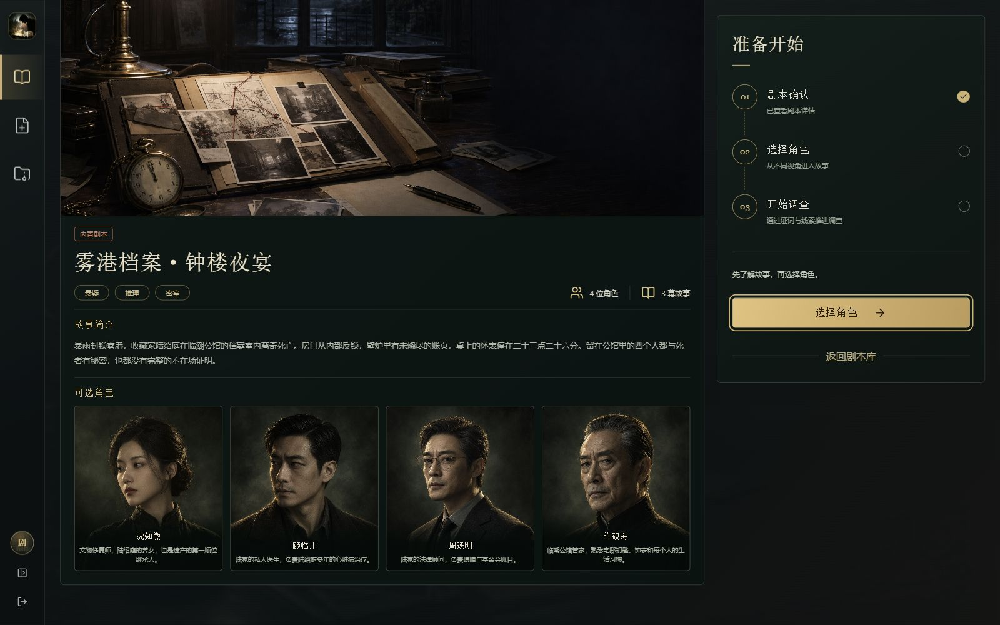
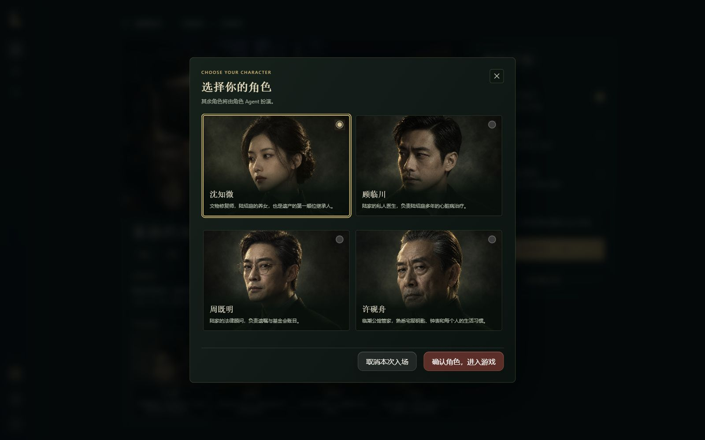
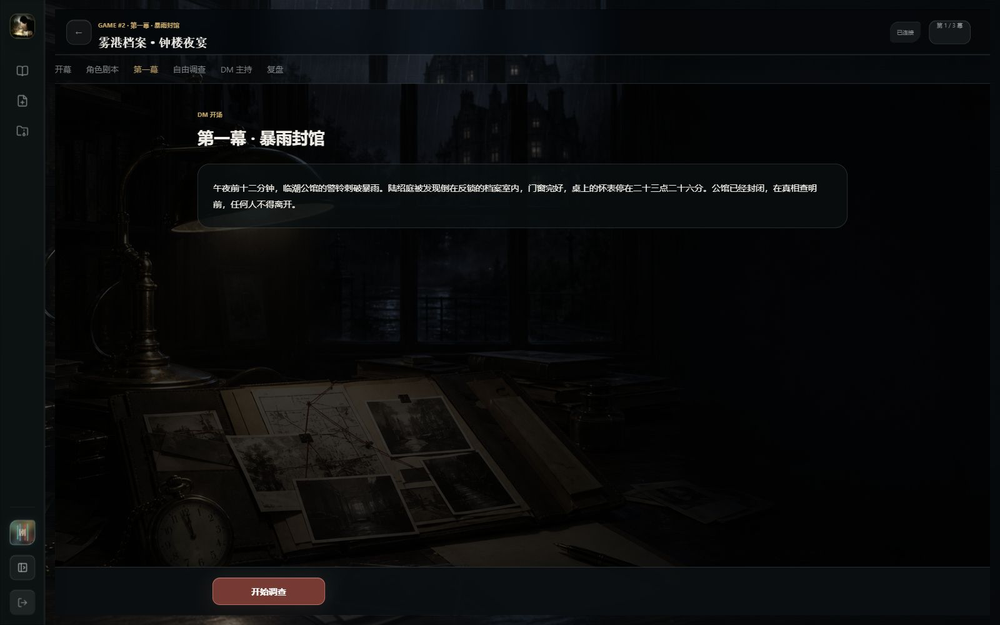
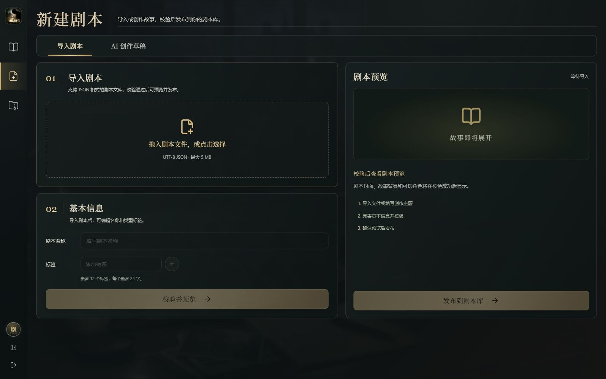

# 剧镜 · AI 剧本杀

由多智能体驱动的 AI 剧本杀 Web 应用。选择角色进入案件，与 AI 角色交流、搜证和推理，由 DM 推进剧情，最终完成指认与复盘。

[核心功能](#核心功能) · [界面预览](#界面预览) · [快速开始](#快速开始) · [怎么玩](#怎么玩) · [技术栈与目录](#技术栈与目录) · [使用注意](#使用注意) · [文档与参考](#文档与参考)

## 核心功能

| 能力 | 说明 |
| --- | --- |
| 案件与角色 | 从内置剧本库选择案件和玩家角色，阅读私人剧本，逐幕展开调查 |
| 多智能体互动 | DM 主持剧情，AI 角色参与公开交流和私密询问，并持有各自的角色信息 |
| 调查与推理 | 现场搜证、线索披露、个人手记、阶段投票与最终指认 |
| 剧本创作 | JSON 导入、AI 草稿、编辑、结构与语义审稿、发布 |
| 案件档案 | 按用户保存案件和手记，支持暂停、恢复与终局复盘 |
| 模型接入 | Echo 流程演示，以及兼容 OpenAI Chat Completions 的模型服务 |

内置六个推理案件：《雾港档案·钟楼夜宴》《雨夜来信》《末班列车》《深海回声》《旧宅回廊》《无声剧院》。

## 界面预览

以下为当前 Web 界面的实际桌面截图，使用独立 Echo 演示数据。截图展示操作界面，真实模型的内容与效果需单独验证。

### 剧本库



### 调查界面



<details>
<summary>更多界面：登录、剧本详情、角色选择、第一幕开场与剧本创作</summary>

### 登录入口


### 剧本详情



### 角色选择



### 第一幕开场



### 剧本创作



</details>

## 快速开始

### Docker 试运行

需要 Docker Engine，或启用 Linux 容器的 Docker Desktop，以及 **Docker Compose 2.24.0+**。宿主机无需安装 Python 或 Node.js；首次构建需要下载基础镜像和依赖。

```sh
git clone https://github.com/Jyx5166/RolePlayingGame.git
cd RolePlayingGame
docker compose up -d --build --wait
```

已克隆仓库时，直接在仓库根目录执行启动命令。

打开 [http://127.0.0.1:8000](http://127.0.0.1:8000)，注册账号后进入剧本库。默认使用 **Echo 演示模式**，无需模型密钥，不调用外部模型，适合检查操作流程；体验 AI 推理与对话需接入真实模型。

### 接入模型

将 [docker.env.example](docker.env.example) 复制为本地 `docker.env`，按供应商信息填写：

```dotenv
LLM_PROVIDER=openai_compatible
LLM_MODEL=your-model-id
LLM_BASE_URL=https://your-provider.example/v1
LLM_API_KEY=your-api-key
```

`LLM_BASE_URL` 填写 API 根地址，应用会追加 `/chat/completions`。然后执行：

```sh
docker compose --env-file docker.env up -d --build --wait
```

后续管理命令也使用同一份 `--env-file docker.env`。本地模型、端口调整和配置生效方式见[部署指南](guides/deployment.md)，完整参数见[配置参考](guides/configuration.md)。

源码运行及 Windows 双击启动方式见[源码部署](guides/deployment.md#源码部署windows)。

## 怎么玩

1. **选择案件与角色**：浏览剧本信息，选择自己扮演的角色。
2. **阅读私人剧本**：了解角色背景、已知信息和个人任务。
3. **逐幕调查**：随 DM 推进剧情，与角色交流、现场搜证、披露线索，并记录手记。
4. **投票与指认**：按当前阶段完成投票和最终指认。
5. **查看复盘**：结束后回看案件记录；未完成的案件可暂停后恢复。

创作入口支持导入 JSON 剧本，也可通过 AI 创作任务生成草稿，编辑、审稿后发布到剧本库。审稿通过不能保证案件具有唯一解或达到预期游戏质量，发布前仍需实际试玩。

## 技术栈与目录

| 部分 | 技术 |
| --- | --- |
| 前端 | Vue 3、Vue Router、Pinia、TanStack Query、TypeScript、Vite |
| 后端 | FastAPI、Pydantic、SQLite |
| 智能体与模型 | LangGraph、兼容 OpenAI Chat Completions 的 API |
| 部署 | Docker Compose，或 Python 同源托管 Web 服务 |

```text
RolePlayingGame/
├── backend/                # 应用、公开配置模板、内置剧本与测试
├── frontend/               # Vue 源码与页面资源
├── launcher/               # 本地 Web 启动器与 Windows 打包脚本
├── media/screenshots/      # README 界面截图
├── guides/                 # 公开使用与开发文档
├── Dockerfile
├── compose.yaml
├── docker.env.example
├── start-local.bat
└── README.md
```

Windows 启动器会启动本地服务并打开系统默认浏览器，当前没有独立桌面窗口。

## 使用注意

- **模型与费用**：真实模型需支持项目使用的工具调用及相关参数；角色自主行动也会产生请求，应结合模型预算和工作流设置控制费用。
- **数据持久化**：Docker 默认将账号、案件和手记等保存在 `jujing_data` 卷。重建容器保留数据，`docker compose down -v` 会删除数据卷；升级前按部署指南停服备份。
- **单实例运行**：保持一个应用容器、一个 worker，避免多个实例共用数据目录。
- **对外访问**：默认只监听宿主机本地端口。公网部署需配置支持 WebSocket 的 HTTPS 反向代理和 Secure Cookie。
- **验证范围**：Echo 演示和自动化测试用于检查流程与回归；健康检查只证明应用可响应，真实模型效果、成本和生产负载需要另外验收。

## 文档与参考

| 文档 | 内容 |
| --- | --- |
| [部署指南](guides/deployment.md) | Docker 与源码部署、启动验收、HTTPS、数据备份恢复、升级及常见问题 |
| [配置参考](guides/configuration.md) | 模型参数、环境变量、Cookie、配置与数据路径、工作流设置 |
| [开发与剧本参考](guides/development.md) | 开发环境、目录与命名、测试、Windows 启动器打包、剧本格式及接口 |

配置模板：[Docker](docker.env.example) · [应用环境变量](backend/config/.env.example) · [游戏工作流](backend/config/workflow.yaml)；剧本格式见 [JSON Schema](backend/resources/schema/script.schema.json)。
